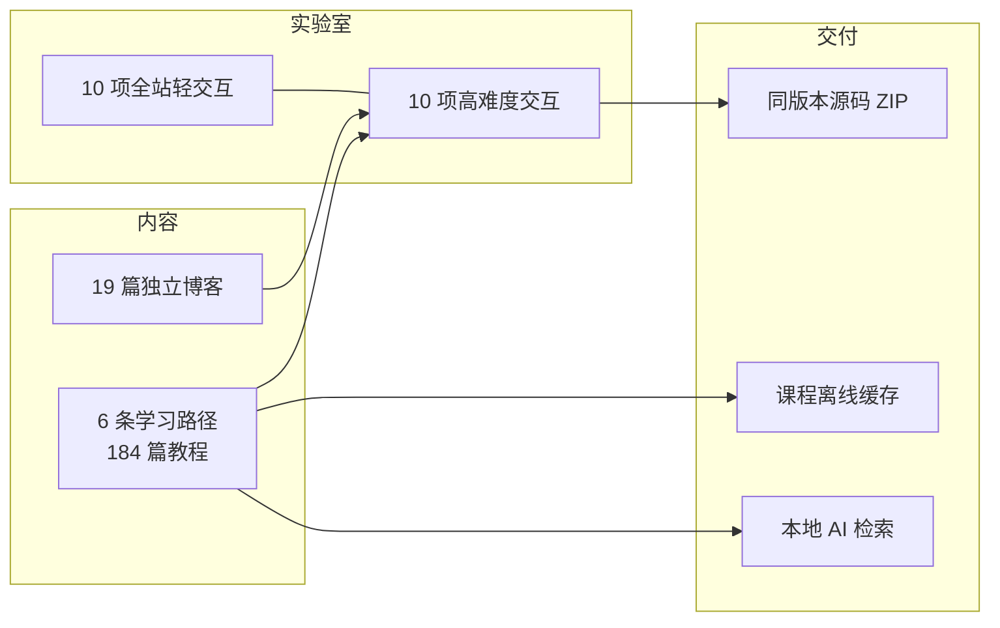

<div align="center">

# ⚡ 阿斌实验室

**把想法写成可靠的软件，把实践沉淀成可复现的教程。**

全栈工程师 · 独立开发者 · Local-first Agent 实践者

[](https://abinzhao.github.io/abinzhao/)
[](https://abinzhao.github.io/abinzhao/labs/)
[](https://abinzhao.github.io/abinzhao/columns/)


</div>

> 这里不是简历，而是一个可以当场验证的工程现场：**打开实验 → 读实现 → 下载同版本源码 → 本地跑起来**。

---

## 🧪 十项可以上手玩的实验

| 实验 | 你会看到什么 | 技术 |
| :-- | :-- | :-- |
| [代码粒子场](https://abinzhao.github.io/abinzhao/labs/particles.html) | 同一组粒子在聚合、流动与回归之间演化，可调密度与速度 | WebGPU Compute · Canvas2D 降级 |
| [光谱材质台](https://abinzhao.github.io/abinzhao/labs/spectral.html) | 拖动光源，观察玻璃、薄膜色散与金属高光的实时变化 | WebGL2 · GLSL |
| [渲染管线拆解](https://abinzhao.github.io/abinzhao/labs/rendering.html) | 逐步查看 DOM → Style → Layout → Paint → Composite，对比 width 与 transform | Scroll Timeline · SVG |
| [教程知识图谱](https://abinzhao.github.io/abinzhao/labs/knowledge-graph.html) | 沿真实课程与先修关系探索全站内容 | Worker · Canvas2D |
| [站点空间剖面](https://abinzhao.github.io/abinzhao/labs/layers.html) | 展开本站界面、状态、计算与存储的职责分层 | CSS 3D · Pointer Events |
| [共享元素导航](https://abinzhao.github.io/abinzhao/labs/page-transition.html) | 实验身份跨越页面连续过渡，普通导航仍然可靠 | View Transitions |
| [代码演化时间轴](https://abinzhao.github.io/abinzhao/labs/code-morph.html) | 逐步改进一段真实代码，源码、解释与预览同步 | WAAPI · 稳定标识 |
| [可打断的空间重排](https://abinzhao.github.io/abinzhao/labs/project-layout.html) | 切换排序、密度与语言筛选，重排中仍可继续操作 | FLIP · WAAPI |
| [执行轨迹显微镜](https://abinzhao.github.io/abinzhao/labs/execution.html) | 给受控示例不同输入，核对每一步执行、变量与结果 | AbortController |
| [作品时间线](https://abinzhao.github.io/abinzhao/labs/timeline.html) | 用可核查的提交记录连接作品、源码与教程 | SVG · ResizeObserver |

## 🗺️ 站点如何运转



## 📚 六条学习路径

| 路径 | 内容 | 章节 |
| :-- | :-- | --: |
| [Agent Harness](https://abinzhao.github.io/abinzhao/columns/agent-harness/) | Agent 循环、Skills、MCP、上下文、工具、安全、恢复、多 Agent、SDK 与评测 | 73 |
| [全栈开发](https://abinzhao.github.io/abinzhao/columns/fullstack-development/) | JavaScript / TypeScript、React、Node.js、PostgreSQL、认证、安全、测试与运维 | 55 |
| [Agent 产品经理](https://abinzhao.github.io/abinzhao/columns/agent-product-manager/) | 任务发现、产品规格、权限恢复、评测统计、成本、治理与运维 | 16 |
| [Godot](https://abinzhao.github.io/abinzhao/columns/godot/) | GDScript、2D、UI、存档、AI、音频、3D、性能与完整收集关卡 | 16 |
| [uni-app](https://abinzhao.github.io/abinzhao/columns/uni-app/) | Vue 3、TypeScript、平台边界、状态、请求与跨端能力适配 | 12 |
| [微信小程序](https://abinzhao.github.io/abinzhao/columns/wechat-mini-program/) | 原生 TypeScript、生命周期、网络、身份、隐私与性能 | 12 |

## ⚡ 性能与工程

| 指标 | 结果 | 条件 |
| :-- | :-- | :-- |
| 首页 LCP | **0.75 s** 中位数 | 本地生产构建 · 390×844 · 1.6 Mbps · CPU 4× |
| 文章 LCP | **0.82 s** 中位数 | 同上，五轮取中位数 |
| 首屏 JS | **97 KiB** 首页 / **105 KiB** 文章 | gzip，预算上限 110 KiB |
| 首屏 CSS | **23 KiB** | gzip，预算上限 25 KiB |
| GPU 帧率 | **60 fps**，p95 16.7 ms | M3 Pro · Chrome 156 · 采样 30 s |
| 自动化检查 | **326 项** | 类型 · 单测 · 浏览器回归 · 生产资源与离线 |

- 图形实验只在用户点击后加载；启动前实验、模型与知识库资源均为 0 请求。
- 粒子优先 WebGPU，缺失时降级 Canvas2D；光谱材质使用 WebGL2，两者都支持离屏暂停与显式销毁。
- 连续两秒平均帧率不足 50 fps 时逐级降低像素比，最低档仍不足则切回静态预览。
- 系统「减少动态效果」优先于站内设置；关闭 JavaScript 后文章正文仍可阅读。
- 以上为本机同条件实测与预算目标，不代表真实手机或现场 INP。

## 🧠 本地优先的 AI 助手

站内问答完全在浏览器运行：本地检索索引与正文，问题、历史与文章上下文不出端。生成式模型需要显式下载才会启用，默认使用可核查的本地检索路径。

## 🌿 分支与发布

- **`dev`** — 站点源码、内容与功能的唯一维护线，也是 GitHub Pages 的唯一构建来源。
- **`master`** — 仅保留本 README，作为个人介绍入口。

推送 `dev` 会触发完整流水线：类型检查 → 单元测试 → 浏览器回归 → 生产资源与离线校验 → 构建 → 部署 → 线上版本与链接核对。

## 🚀 本地运行

```sh
git clone https://github.com/abinzhao/abinzhao.git
cd abinzhao
git switch dev        # 站点源码只在这里维护
pnpm install
pnpm dev              # http://127.0.0.1:5201
pnpm verify           # 类型 + 单测 + 浏览器回归 + 构建 + 生产校验
```

需要 Node.js 22+ 与 pnpm 10；站点默认前缀为 `/abinzhao/`。

---

<div align="center">

**[在线站点](https://abinzhao.github.io/abinzhao/)** · **[实验室](https://abinzhao.github.io/abinzhao/labs/)** · **[专题教程](https://abinzhao.github.io/abinzhao/columns/)** · **[GitHub](https://github.com/abinzhao)**

<sub>Built with VitePress · Vue 3 · TypeScript · WebGPU / WebGL2</sub>

</div>
